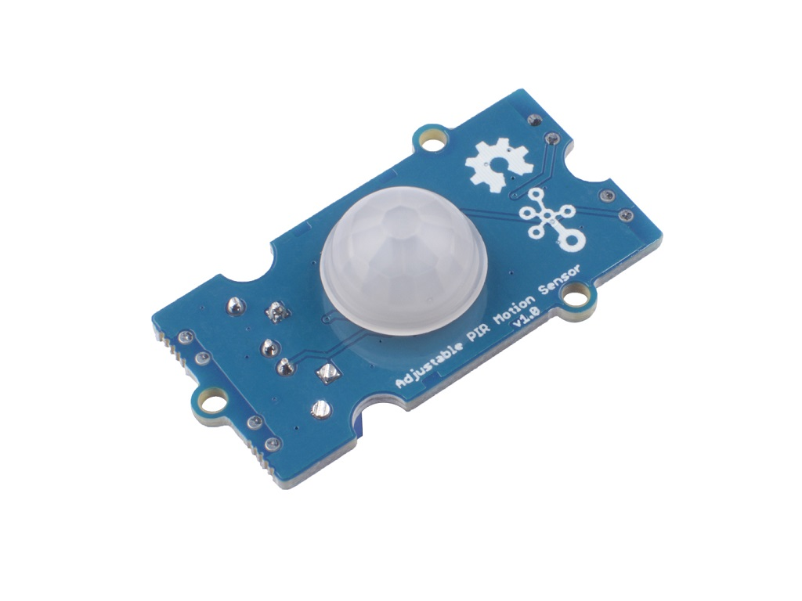

# 16 - Détecteur de mouvements

## Contenu

- [**1 – Grove Adjustable PIR Motion Sensor**](#section-1)
- [**2 – Exemple d'utilisation**](#section-2)
- [**3 – Défi informatique**](#section-3)

---

## 1 – Grove Adjustable [PIR Motion Sensor](https://wiki.seeedstudio.com/Grove-Adjustable_PIR_Motion_Sensor/) {#section-1}



## Type de connexion : <span style="color:#00d084">digitale</span>

---

## 2 – Exemple d'utilisation {#section-2}

```cpp
/*
    Auteur:       Alain Boudreault
    Date:         2021.10.26
    Clientèle:    Étudiant(e)s du cours 420-1C4: Objets connectés de CSTJ.
    Description:  Allumer une DEL si une personne est détectée dans la zone
                  de captation du module Grove 'Adjustable PIR Motion Sensor'.

    Référence:    https://wiki.seeedstudio.com/Grove-Adjustable_PIR_Motion_Sensor/              
*/

#define PIR_MOTION_SENSOR 6 
#define LED 3. 
 
void setup()
{
    // Initialiser les broches pour la DEL et le détecteur de mouvements
    initialiserLesBrochesDuArduino();
} // setup
 
void loop() 
{
    iYatiKekun() ? allumerLaDEL() : eteindreLaDEL();
} // loop

/* ---------------------------------------------------------
   Fonction: Initialiser les broches du Arduino   
   Retour:   void   
   ------------------------------------------------------ */
void initialiserLesBrochesDuArduino()
{
    pinMode(PIR_MOTION_SENSOR, INPUT);
    pinMode(LED,OUTPUT);
} // initialiserLesBrochesDuArduino

/* ---------------------------------------------------------
   Fonction: Allumer la DEL connectée à la broche DEL   
   Retour:   void   
   ------------------------------------------------------ */
void allumerLaDEL()
{
    digitalWrite(LED,HIGH);
} // allumerLaDEL

/* ---------------------------------------------------------
   Fonction: Éteindre la DEL connectée à la broche DEL   
   Retour:   void   
   ------------------------------------------------------ */
void eteindreLaDEL()
{
    digitalWrite(LED,LOW);
} // eteindreLaDEL

/* ---------------------------------------------------------
   Fonction: Détecter une personne dans la zone du capteur.   
   Retour:   boolean, retourne 'vrai' s'il y a détection.   
   ---------------------------------------------------------        
*/
boolean iYatiKekun()
{
    int sensorValue = digitalRead(PIR_MOTION_SENSOR);
    if(sensorValue == HIGH) // si valeur du capteur PIR est HIGH (1) alors
    {
        return true;   // Oh, il y a un coquin qui est passé devant le capteur!
    }
    else
    {
        return false;  // Et ben non :-(, pas de visite ...
    }
}
```

---

## 3 – Défi informatique {#section-3}

Optimiser la fonction ***iYaTiKekun***() pour utiliser le moins de code possible.

---

###### Document rédigé par Alain Boudreault (aka: VE2CUY) – 2021.10.26 – Révision 2026.11.07

*Contenu par [VE2CUY](https://ve2cuy.github.io/blog/)*
