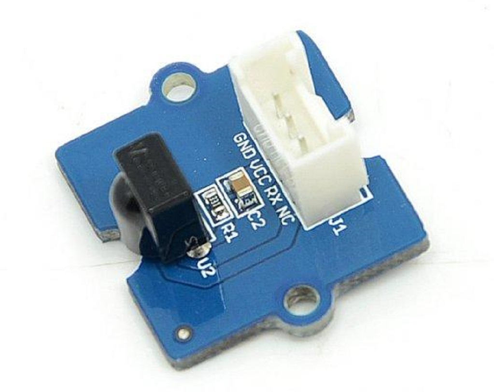
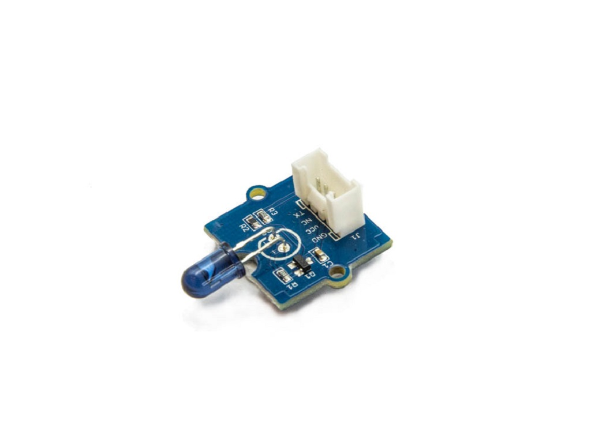

# 26 - Infrarouge : récepteur et émetteur

*Révision du 2026.11.07*



## Objectif de la lecture

À la fin de cette lecture, nous devrions être capable d'expliquer comment une télécommande infrarouge communique avec un appareil, de **lire** les codes des touches d'une télécommande avec le module Grove **Infrared Receiver**, d'utiliser ces codes pour **contrôler** un objet connecté et de **transmettre** nos propres codes avec le module Grove **Infrared Emitter**.

*A.B. aka ve2cuy*

---

## Contenu

1. [**La lumière infrarouge et les télécommandes**](#section-1)
2. [**Le module Grove – Infrared Receiver**](#section-2)
3. [**Installation de la librairie Seeed Arduino IR**](#section-3)
4. [**Lire les codes d'une télécommande**](#section-4)
5. [**Contrôler une DEL avec une télécommande**](#section-5)
6. [**Le module Grove – Infrared Emitter**](#section-6)
7. [**Transmettre un code infrarouge**](#section-7)
8. [**Laboratoires**](#section-8)

---

## 1 – La lumière infrarouge et les télécommandes {#section-1}

La lumière **infrarouge** (IR) est une lumière invisible pour l'œil humain. Celle utilisée par les télécommandes a une longueur d'onde d'environ **940 nm** (nanomètres).

Le problème? Nous sommes entourés de sources d'infrarouge: le soleil, les ampoules, le chauffage, notre propre corps, etc.

Pour que le récepteur ne confonde pas le signal de la télécommande avec la lumière ambiante, la DEL infrarouge de la télécommande **clignote très rapidement**, à une fréquence fixe appelée la **porteuse** (*carrier*). La plus utilisée est de **38 kHz**, c'est-à-dire 38 000 clignotements par seconde.

Le récepteur ne retient que la lumière qui clignote à cette fréquence. C'est ce qu'on appelle la **modulation**.

Chaque touche de la télécommande envoie une suite d'impulsions (des périodes avec et sans porteuse) qui forme un **code**. La façon de construire ce code est un **protocole**. Chaque fabricant a le sien. Par exemple:

| Protocole | Utilisé par | Nombre de bits du code |
|-----------|-------------|------------------------|
| **NEC** | Nombreux appareils et télécommandes génériques | 32 |
| **Sony** (SIRC) | Appareils Sony | 12, 15 ou 20 |
| **RC5/RC6** | Philips | 13 à 20 |

*Tableau 01*

> Note: Dans un appareil photo de téléphone cellulaire, il est souvent possible de **voir** la DEL d'une télécommande clignoter lorsqu'on appuie sur une touche 😊. Essayez-le!

---

## 2 – Le module Grove – Infrared Receiver {#section-2}

## Type de connexion: <span style="color:#00d084">digitale</span>

Le module **Grove – Infrared Receiver** reçoit les signaux infrarouges. Son détecteur (un TSOP382 de Vishay) contient un **démodulateur** qui ne réagit qu'à l'infrarouge modulé à **38 kHz**.

Il retire la porteuse et remet à l'Arduino, sur la broche de signal, seulement la suite d'impulsions du code. C'est à notre programme (à la librairie) de mesurer ces impulsions et de les décoder.

| Spécification | Valeur |
|---------------|--------|
| Tension d'alimentation | 3.3 à 5 volts |
| Fréquence de la porteuse | 38 kHz |
| Portée | Environ 10 mètres |
| Connexion | Digitale (fil jaune du connecteur Grove) |

*Tableau 02*

**Branchement**: Connecter le module sur le connecteur **D2** du Grove-Hat.

> 💡Rappel: Le connecteur D2 du Grove-Hat présente les broches 2 et 3, la broche 2 étant celle qui est utilisée par le module.

La librairie utilise une **interruption** pour mesurer les impulsions. Sur l'Arduino Uno, le récepteur doit donc être branché sur une broche qui supporte les interruptions, comme la **broche 2**.

---

## 3 – Installation de la librairie Seeed Arduino IR {#section-3}

Seeed Studio propose la librairie **Seeed Arduino IR**, une version de la librairie **IRLib2** de Chris Young. Elle permet de **recevoir**, de **décoder** et de **transmettre** des signaux infrarouges.

Voici la dépendance à utiliser sous PlatformIO:

```ini
lib_deps = seeed-studio/Seeed Arduino IR @ ^1.0.2
```

Sous l'IDE Arduino, la librairie est disponible sur [GitHub](https://github.com/Seeed-Studio/Seeed_Arduino_IR).

**ATTENTION**: Il existe plusieurs librairies infrarouges (IRremote, IRLib2, etc.) qui utilisent les mêmes noms de fichiers. Il ne faut en installer **qu'une seule** dans un même projet.

---

## 4 – Lire les codes d'une télécommande {#section-4}

Ce premier exemple affiche, dans la console série, le protocole et le code de chaque touche reçue.

Utiliser n'importe quelle télécommande de la maison (téléviseur, climatiseur, lecteur, etc.).

```cpp
/*
    Fichier:      ir-lire-codes.cpp
    Auteur:       Alain Boudreault
    Date:         2026.11.07
    Clientèle:    Étudiant(e)s du cours 420-1C4: Objets connectés de CSTJ.
    --------------------------------------------------------------------------
    Description:  Afficher, dans la console série, le protocole et le code
                  des touches d'une télécommande infrarouge.
    Module:       Grove - Infrared Receiver sur D2
    Référence:    https://wiki.seeedstudio.com/Grove-Infrared_Receiver/
    --------------------------------------------------------------------------
*/
#include <Arduino.h>
// Toute la librairie: simple, mais le programme sera plus gros.
#include <IRLibAll.h>

#define BROCHE_RECEPTEUR_IR   2
#define VITESSE_UART          9600

IRrecvPCI recepteurIR(BROCHE_RECEPTEUR_IR);  // Le récepteur (utilise une interruption)
IRdecode  decodeurIR;                        // Le décodeur des protocoles (NEC, Sony, ...)

void setup() {
  Serial.begin(VITESSE_UART);
  recepteurIR.enableIRIn();                  // Démarrer la réception
  Serial.println(F("Prêt à recevoir les signaux infrarouges ..."));
} // setup()

void loop() {
  // getResults() retourne vrai lorsqu'un signal complet a été reçu
  if (recepteurIR.getResults()) {
    decodeurIR.decode();                     // Décoder le signal
    decodeurIR.dumpResults(false);           // Afficher le résultat (false = version courte)
    recepteurIR.enableIRIn();                // Redémarrer la réception
  }
} // loop()
```

👉 Tester l'application et appuyer sur quelques touches de la télécommande.

**Explication du code:**

- `IRrecvPCI recepteurIR(2)`: Le récepteur, branché sur la broche 2.
- `enableIRIn()`: Démarre (ou redémarre) la réception. Il faut le refaire après chaque signal reçu.
- `getResults()`: Retourne **vrai** lorsqu'un signal complet a été reçu.
- `decode()`: Identifie le protocole et calcule la valeur du code.
- `dumpResults(false)`: Affiche le protocole, la valeur du code (en hexadécimal) et son nombre de bits.

> Note: Avec le protocole **NEC**, une touche qui reste enfoncée envoie un **code de répétition** (la valeur 0xFFFFFFFF) plutôt que de répéter le code de la touche.

> Note: Si le protocole affiché est **inconnu** (*UNKNOWN*), la télécommande utilise un protocole que la librairie ne sait pas décoder. Essayer une autre télécommande.

---

## 5 – Contrôler une DEL avec une télécommande {#section-5}

Une fois les codes des touches connus, il est possible de les utiliser dans un programme.

La classe `IRdecode` expose, après l'appel de `decode()`, les propriétés suivantes:

| Propriété | Description |
|-----------|-------------|
| `protocolNum` | Le protocole reconnu: `NEC`, `SONY`, `RC5`, `UNKNOWN`, etc. |
| `value` | La valeur du code de la touche |
| `bits` | Le nombre de bits du code |

*Tableau 03*

Dans l'exemple suivant, la touche **1** allume la DEL et la touche **2** l'éteint.

**IMPORTANT**: Remplacer les valeurs des macros `TOUCHE_1` et `TOUCHE_2` par les codes obtenus à la section 4 avec **votre** télécommande.

```cpp
/*
    Fichier:      ir-controler-del.cpp
    Auteur:       Alain Boudreault
    Date:         2026.11.07
    --------------------------------------------------------------------------
    Description:  Allumer et éteindre une DEL avec deux touches d'une
                  télécommande infrarouge de protocole NEC.
    Modules:      Grove - Infrared Receiver sur D2, DEL sur D4
    --------------------------------------------------------------------------
*/
#include <Arduino.h>
#include <IRLibDecodeBase.h>    // La base du décodeur
#include <IRLib_P01_NEC.h>      // Seulement le protocole utilisé: programme plus petit
#include <IRLibCombo.h>         // Après tous les protocoles
#include <IRLibRecvPCI.h>       // Le récepteur

#define BROCHE_RECEPTEUR_IR   2
#define BROCHE_DEL            4
#define VITESSE_UART          9600

// Codes des touches: à remplacer par ceux de votre télécommande (section 4)
#define TOUCHE_1              0xFF30CF
#define TOUCHE_2              0xFF18E7

IRrecvPCI recepteurIR(BROCHE_RECEPTEUR_IR);
IRdecode  decodeurIR;

void setup() {
  Serial.begin(VITESSE_UART);
  pinMode(BROCHE_DEL, OUTPUT);
  recepteurIR.enableIRIn();
  Serial.println(F("Touche 1: allumer, touche 2: éteindre"));
} // setup()

void loop() {
  if (recepteurIR.getResults()) {
    decodeurIR.decode();
    if (decodeurIR.protocolNum == NEC) {
      switch (decodeurIR.value) {
        case TOUCHE_1: digitalWrite(BROCHE_DEL, HIGH);
                       Serial.println(F("DEL allumée"));
                       break;
        case TOUCHE_2: digitalWrite(BROCHE_DEL, LOW);
                       Serial.println(F("DEL éteinte"));
                       break;
        default:       Serial.print(F("Touche non utilisée: 0x"));
                       Serial.println(decodeurIR.value, HEX);
      } // switch
    } // if NEC
    recepteurIR.enableIRIn();
  } // if getResults()
} // loop()
```

👉 Tester l'application.

> 💡Remarquer l'inclusion, une par une, des parties de la librairie. Le programme est plus petit qu'avec `IRLibAll.h`. Comparer la taille mémoire affichée à la compilation des deux exemples (sur le Uno: environ 12 Ko de mémoire Flash avec `IRLibAll.h`, contre 5 Ko ici).

---

## 6 – Le module Grove – Infrared Emitter {#section-6}



## Type de connexion: <span style="color:#00d084">digitale</span>

Le module **Grove – Infrared Emitter** contient une DEL infrarouge (une TSAL6200 de Vishay) qui permet à l'Arduino de **transmettre** des codes, comme le ferait une télécommande. Il est habituellement utilisé avec le Grove – Infrared Receiver.

| Spécification | Valeur |
|---------------|--------|
| Tension d'alimentation | 3.3 ou 5 volts |
| Longueur d'onde | 940 nm |
| Angle d'émission | ± 17° |
| Portée | Jusqu'à 10 mètres |

*Tableau 04*

L'angle d'émission est étroit: il faut **pointer** l'émetteur vers le récepteur, comme on le fait avec une télécommande.

**Branchement**: Connecter le module sur le connecteur **D3** du Grove-Hat.

**ATTENTION**: La broche de l'émetteur **n'est pas un choix**. La librairie produit la porteuse de 38 kHz avec un minuteur matériel (*Timer 2*) qui ne pilote qu'une seule broche:

| Carte | Broche de l'émetteur |
|-------|----------------------|
| Arduino Uno (ATmega328P) | **3** |
| Arduino Mega (ATmega2560) | **9** |

*Tableau 05*

> Note: Ce minuteur sert aussi à la fonction `analogWrite()` (PWM) des broches 3 et 11 sur le Uno. Il ne faut pas utiliser le PWM sur ces broches dans un projet qui transmet de l'infrarouge.

---

## 7 – Transmettre un code infrarouge {#section-7}

L'exemple suivant transmet un code chaque fois que le bouton est appuyé. Il utilise un deuxième Arduino, avec le récepteur et le programme de la section 4, pour afficher le code reçu.

```cpp
/*
    Fichier:      ir-transmettre.cpp
    Auteur:       Alain Boudreault
    Date:         2026.11.07
    --------------------------------------------------------------------------
    Description:  Transmettre un code infrarouge à chaque appui du bouton.
    Modules:      Grove - Infrared Emitter sur D3 (obligatoire sur le Uno),
                  bouton sur D4
    Référence:    https://wiki.seeedstudio.com/Grove-Infrared_Emitter/
    --------------------------------------------------------------------------
*/
#include <Arduino.h>
#include <IRLibSendBase.h>      // La base de l'émetteur
#include <IRLib_P01_NEC.h>      // Les protocoles utilisés: le plus petit numéro en premier
#include <IRLib_P02_Sony.h>
#include <IRLibCombo.h>         // Après tous les protocoles

#define BROCHE_BOUTON         4
#define VITESSE_UART          9600
#define DELAI_REBOND          50

#define CODE_A_TRANSMETTRE    0xFF30CF   // Un code NEC de 32 bits

IRsend emetteurIR;              // L'émetteur: la broche est imposée par la librairie (3 sur le Uno)

void setup() {
  Serial.begin(VITESSE_UART);
  pinMode(BROCHE_BOUTON, INPUT);
  Serial.println(F("Appuyer sur le bouton pour transmettre"));
} // setup()

void loop() {
  if (digitalRead(BROCHE_BOUTON)) {
    emetteurIR.send(NEC, CODE_A_TRANSMETTRE, 32);
    // Pour un appareil Sony: emetteurIR.send(SONY, 0xA8BCA, 20);
    Serial.print(F("Code transmis: 0x"));
    Serial.println(CODE_A_TRANSMETTRE, HEX);
    while (digitalRead(BROCHE_BOUTON));   // Attendre le relâchement du bouton
    delay(DELAI_REBOND);                  // Éliminer le bruit du bouton
  }
} // loop()
```

**Explication du code:**

- `IRsend emetteurIR`: L'émetteur, qui contient seulement les protocoles inclus (NEC et Sony).
- `send(protocole, code, nombreDeBits)`: Transmet le code avec la porteuse du protocole.

👉 Tester l'application avec deux Arduino: l'un transmet, l'autre affiche le code reçu.

> 💡Avec le code d'une touche de votre télécommande (section 4), l'Arduino peut maintenant **remplacer** cette télécommande. Par exemple, allumer le téléviseur 😊.

---

## 8 – Laboratoires {#section-8}

### 8.1 – Laboratoire (durée 20 minutes)


<br>

Avec le programme de la section 4, relever le protocole et les codes des touches **0** à **9**, **+** et **–** d'une télécommande.

Inscrire ces codes dans un fichier d'entête `include/telecommande.h`, sous forme de macros (`TOUCHE_0`, `TOUCHE_1`, etc.).

---

### 8.2 – Laboratoire (durée 30 minutes)


<br>

Écrire un programme qui:

* allume la DEL connectée sur D4 avec la touche **1** et l'éteint avec la touche **2**,
* varie l'intensité d'une DEL connectée sur **D5** avec les touches **+** et **–**, par pas de 25 (fonction `analogWrite()`),
* affiche sur l'écran LCD le nom de la dernière touche reçue et l'intensité de la DEL.

**Note**: Utiliser une instruction `switch` et les macros du fichier `telecommande.h`.

---

### 8.3 – Laboratoire en équipe (durée 30 minutes)


<br>

Deux équipes, deux Arduino:

* L'**émetteur** transmet un code différent pour chacun de ses deux boutons.
* Le **récepteur** allume une DEL rouge pour le premier code et une DEL verte pour le deuxième, puis affiche le code reçu dans la console série.

Mesurer la portée maximale de la communication et l'angle à partir duquel le récepteur ne reçoit plus le signal.

---

## Défi informatique

Utiliser une télécommande pour naviguer dans le menu du projet de session (TP01), à la place des boutons: flèches pour changer d'option, **OK** pour la choisir.

---

## Références

- [Grove – Infrared Receiver](https://wiki.seeedstudio.com/Grove-Infrared_Receiver/) (Seeed Studio)
- [Grove – Infrared Emitter](https://wiki.seeedstudio.com/Grove-Infrared_Emitter/) (Seeed Studio)
- [Librairie Seeed Arduino IR](https://github.com/Seeed-Studio/Seeed_Arduino_IR) et ses exemples (`dump`, `send`, `rawRecv`, `rawSend`)

---

## Crédits

*Document rédigé par Alain Boudreault © 2021-2026*  
*Version 2026.11.07.1*  

*Contenu par [VE2CUY](https://ve2cuy.github.io/blog/)*
