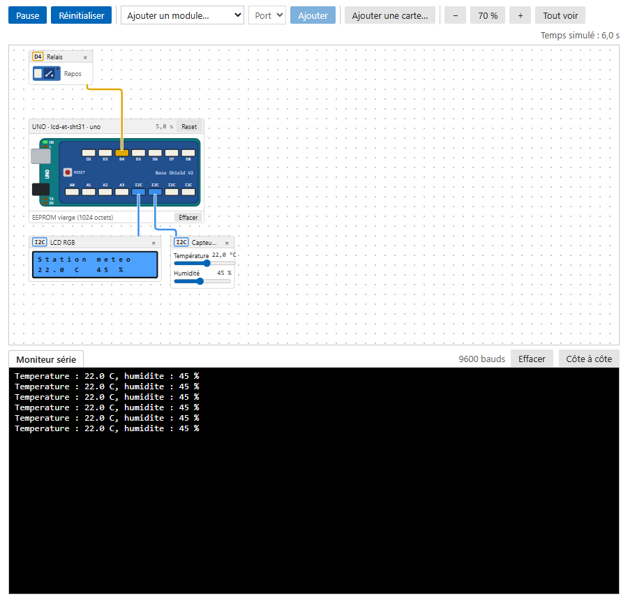
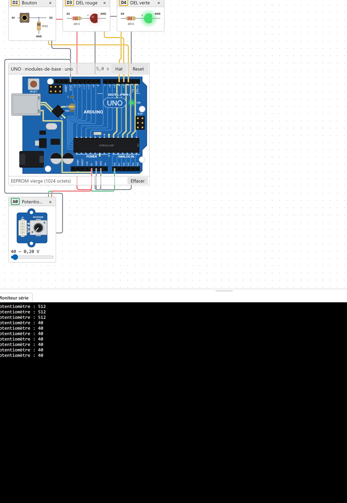
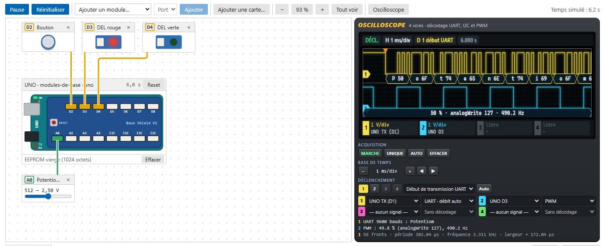

# Simulateur d'Arduino pour VS Code

*Révision du 2026.11.20*

<p align="center">
  
</p>

## Contenu

- [**Définition**](#section-definition)
- [**1 – Installer l'extension**](#section-1)
  - [1.1 – Ce qu'il faut déjà avoir](#section-1-1)
  - [1.2 – L'installer depuis la boutique d'extensions](#section-1-2)
  - [1.3 – Autre façon : le fichier .vsix](#section-1-3)
  - [1.4 – Vérifier l'installation](#section-1-4)
  - [1.5 – Mettre à jour ou désinstaller](#section-1-5)
- [**2 – Premier essai**](#section-2)
  - [2.1 – Les exemples du cours](#section-2-1)
- [**3 – Brancher des modules**](#section-3)
  - [3.1 – Les modules disponibles](#section-3-1)
  - [3.2 – Les ports du hat Grove](#section-3-2)
  - [3.3 – Avec ou sans le hat](#section-3-3)
- [**4 – Le panneau du simulateur**](#section-4)
- [**5 – L'oscilloscope**](#section-5)
  - [5.1 – Observer un signal](#section-5-1)
  - [5.2 – Décoder UART, I2C et PWM](#section-5-2)
  - [5.3 – Le déclenchement](#section-5-3)
  - [5.4 – Mesurer et explorer](#section-5-4)
- [**6 – Deux Arduino reliés par UART**](#section-6)
  - [6.1 – Un projet complet à télécharger : la station Grove](#section-6-1)
- [**7 – Le Wi-Fi et l'API du projet de session**](#section-7)
- [**8 – Les fichiers ajoutés au projet**](#section-8)
- [**9 – Limites et dépannage**](#section-9)

---

## Définition {#section-definition}

Le **simulateur d'Arduino** est une extension de VS Code. Il fait tourner le programme compilé par PlatformIO dans un Arduino virtuel, affiché dans un panneau à côté du code : une carte **UNO** ou **MEGA**, son hat Grove, les modules qu'on y branche et le moniteur série. Les cartes et les modules y sont dessinés d'après les vrais : on peut comparer son montage à celui de l'écran.

Le code du projet reste tel quel : c'est le même programme qui sera téléversé dans la vraie carte.

L'interface du simulateur est en français ou en anglais, selon la langue de VS Code.

Le simulateur sert à travailler **sans le kit**, à la maison par exemple. Il ne remplace pas le matériel : un montage se valide toujours sur la vraie carte, avec les vrais modules.

---

## 1 – Installer l'extension {#section-1}

### 1.1 – Ce qu'il faut déjà avoir {#section-1-1}

- **VS Code**, version 1.85 ou plus récente.
- L'extension **PlatformIO IDE**, installée comme dans le document [Introduction à PlatformIO](PlatformIO-Hello-world.md) : c'est elle qui compile les projets.

### 1.2 – L'installer depuis la boutique d'extensions {#section-1-2}

Le simulateur est publié dans la boutique d'extensions de VS Code (le *Visual Studio Marketplace*) :

1. Ouvrir VS Code.
2. Ouvrir la vue des extensions : **Ctrl+Maj+X**.
3. Chercher **Simulateur Arduino Grove** (éditeur **ve2cuy**).
4. Cliquer sur **Install** (« Installer »).

👉 Page de l'extension : [Simulateur Arduino Grove sur le Visual Studio Marketplace](https://marketplace.visualstudio.com/items?itemName=ve2cuy.simulateur-arduino-grove)

Installée ainsi, l'extension **se met à jour toute seule** quand une nouvelle version est publiée.

### 1.3 – Autre façon : le fichier `.vsix` {#section-1-3}

Sur un poste qui n'a pas accès à la boutique d'extensions, le simulateur s'installe aussi à partir d'un fichier. Un fichier `.vsix` est une extension de VS Code remise sous forme de fichier.

👉 [**simulateur-arduino-grove-1.5.0.vsix**](../telechargements/simulateur-arduino-grove-1.5.0.vsix) (version 1.5.0, environ 285 Ko)

1. Enregistrer le fichier dans un dossier facile à retrouver, par exemple `Téléchargements`.
2. Dans VS Code, ouvrir la vue des extensions : **Ctrl+Maj+X**.
3. Cliquer sur les trois points **…** en haut à droite de cette vue.
4. Choisir **Install from VSIX…** (« Installer à partir d'un VSIX… » si VS Code est en français).
5. Choisir le fichier `simulateur-arduino-grove-1.5.0.vsix` téléchargé.

VS Code confirme l'installation par un message en bas à droite. On peut aussi passer par la palette de commandes (**Ctrl+Maj+P**, puis `Extensions: Install from VSIX`), ou par un terminal, à partir du dossier où se trouve le fichier :

```bash
code --install-extension simulateur-arduino-grove-1.5.0.vsix
```

### 1.4 – Vérifier l'installation {#section-1-4}

1. Dans la vue des extensions, **Simulateur Arduino Grove** apparaît dans la liste des extensions installées.
2. Ouvrir un projet PlatformIO, c'est-à-dire un dossier qui contient le fichier `platformio.ini`.
3. L'icône du simulateur, la puce bleue du cours, apparaît **en haut à droite de l'éditeur**.

💡 L'icône n'apparaît que si le dossier ouvert contient un fichier `platformio.ini`.

### 1.5 – Mettre à jour ou désinstaller {#section-1-5}

- **Mettre à jour** : installée depuis la boutique (section 1.2), l'extension se met à jour toute seule. Installée par le fichier `.vsix` (section 1.3), télécharger la nouvelle version sur cette page et refaire l'installation : elle remplace l'ancienne. Le numéro de la version installée est affiché dans la vue des extensions.
- **Désinstaller** : dans la vue des extensions, cliquer sur la roue dentée de **Simulateur Arduino Grove**, puis sur **Uninstall** (« Désinstaller »).

---

## 2 – Premier essai {#section-2}

1. Ouvrir le projet du document [Introduction à PlatformIO](PlatformIO-Hello-world.md#section-5), celui qui fait clignoter la DEL de la broche 13.
2. **Compiler** le projet : **Ctrl+Alt+B**.
3. Cliquer sur l'**icône du simulateur**, en haut à droite de l'éditeur.

Le panneau s'ouvre à côté du code :

- le voyant **L** de la carte clignote, comme la DEL de la broche 13 de la vraie carte;
- le **moniteur série**, au bas du panneau, affiche ce que le programme envoie par `Serial.print()`. On peut aussi y taper : les touches sont envoyées au programme.

👉 Modifier le délai dans le code, recompiler (**Ctrl+Alt+B**) et observer : la carte **redémarre toute seule** avec le nouveau programme. Il n'y a rien à téléverser.

💡 Le bouton **Reset** relance le programme **déjà compilé** : il ne recompile pas. Après une modification du code, le bouton **Recompiler** apparaît dans l'en-tête de la carte pour le rappeler.

Les mêmes actions se trouvent dans la palette de commandes (**Ctrl+Maj+P**), sous « Simulateur Arduino » :

| Commande | Effet |
|----------|-------|
| Afficher le simulateur | Ouvre le panneau |
| Démarrer la simulation | Lance le programme déjà compilé |
| Compiler et simuler | Enregistre les fichiers, compile, puis lance la simulation |

### 2.1 – Les exemples du cours {#section-2-1}

Dans les notes de cours, un exemple prêt à essayer porte un lien **▶ Ouvrir avec VS Code**. Il s'ouvre avec son **montage déjà fait** :

1. cliquer sur le lien; le navigateur demande la permission d'ouvrir VS Code : l'accepter;
2. dans VS Code, choisir le dossier où créer le projet, par exemple `Documents/PlatformIO/Projects`.

Le simulateur télécharge l'exemple depuis le site du cours (une connexion Internet est nécessaire), le projet s'ouvre et la simulation démarre aussitôt : le programme est fourni déjà compilé. C'est un projet PlatformIO ordinaire, à modifier et à recompiler à votre guise.

| Exemple | Dans les notes | Ouvrir |
|---------|----------------|--------|
| Le premier main.cpp | [Introduction à PlatformIO, section 1.3](PlatformIO-Hello-world.md#section-1-3) | [▶ Ouvrir avec VS Code](vscode://ve2cuy.simulateur-arduino-grove/exemple/pio-1-3) |
| Hello World avec une DEL | [Introduction à PlatformIO, section 5.1](PlatformIO-Hello-world.md#section-5-1) | [▶ Ouvrir avec VS Code](vscode://ve2cuy.simulateur-arduino-grove/exemple/hello-world-del) |
| Hello World avec des macros | [Introduction à PlatformIO, section 5.2](PlatformIO-Hello-world.md#section-5-2) | [▶ Ouvrir avec VS Code](vscode://ve2cuy.simulateur-arduino-grove/exemple/hello-world-macros) |
| Un fichier d'en-tête (.h) | [Introduction à PlatformIO, section 6](PlatformIO-Hello-world.md#section-6) | [▶ Ouvrir avec VS Code](vscode://ve2cuy.simulateur-arduino-grove/exemple/pio-6) |
| Allumer la DEL sur D13 | [Arduino IDE – Hello world, section 1](Hello-world.md#section-1) | [▶ Ouvrir avec VS Code](vscode://ve2cuy.simulateur-arduino-grove/exemple/hello-1) |
| Faire clignoter la DEL | [Arduino IDE – Hello world, section 2](Hello-world.md#section-2) | [▶ Ouvrir avec VS Code](vscode://ve2cuy.simulateur-arduino-grove/exemple/blink-del) |
| Clignoter la DEL : code documenté | [Arduino IDE – Hello world, section 3](Hello-world.md#section-3) | [▶ Ouvrir avec VS Code](vscode://ve2cuy.simulateur-arduino-grove/exemple/hello-3) |
| Clignoter la DEL avec des macros | [Arduino IDE – Hello world, section 4](Hello-world.md#section-4) | [▶ Ouvrir avec VS Code](vscode://ve2cuy.simulateur-arduino-grove/exemple/hello-4) |
| Afficher au moniteur série | [Arduino – Serial.println() et digitalRead(), section 1.8](Serial-println-et-digitalread.md#section-1-8) | [▶ Ouvrir avec VS Code](vscode://ve2cuy.simulateur-arduino-grove/exemple/serial-1-8) |
| Streaming.h | [Arduino – Serial.println() et digitalRead(), section 1.10](Serial-println-et-digitalread.md#section-1-10) | [▶ Ouvrir avec VS Code](vscode://ve2cuy.simulateur-arduino-grove/exemple/serial-1-10) |
| La fonction digitalRead() | [Arduino – Serial.println() et digitalRead(), section 2.1](Serial-println-et-digitalread.md#section-2-1) | [▶ Ouvrir avec VS Code](vscode://ve2cuy.simulateur-arduino-grove/exemple/serial-2-1) |
| Bouton et DEL : exemple documenté | [Arduino – Serial.println() et digitalRead(), section 2.6](Serial-println-et-digitalread.md#section-2-6) | [▶ Ouvrir avec VS Code](vscode://ve2cuy.simulateur-arduino-grove/exemple/serial-2-6) |
| L'instruction while | [Arduino – Serial.println() et digitalRead(), section 3.1.1](Serial-println-et-digitalread.md#section-3-1) | [▶ Ouvrir avec VS Code](vscode://ve2cuy.simulateur-arduino-grove/exemple/serial-3-1-1) |
| Résistance de rappel interne (INPUT_PULLUP) | [Arduino – Serial.println() et digitalRead(), section 4.1](Serial-println-et-digitalread.md#section-4-1) | [▶ Ouvrir avec VS Code](vscode://ve2cuy.simulateur-arduino-grove/exemple/serial-4-1) |
| Permuter une DEL avec un bouton | [Arduino – Serial.println() et digitalRead(), section 5.1](Serial-println-et-digitalread.md#section-5-1) | [▶ Ouvrir avec VS Code](vscode://ve2cuy.simulateur-arduino-grove/exemple/serial-5-1) |
| Anti-rebond d'un bouton | [Arduino – Serial.println() et digitalRead(), section 6](Serial-println-et-digitalread.md#section-6) | [▶ Ouvrir avec VS Code](vscode://ve2cuy.simulateur-arduino-grove/exemple/serial-6) |
| Lire le potentiomètre | [Arduino – AnalogRead, section 1.1](analogRead.md#section-1-1) | [▶ Ouvrir avec VS Code](vscode://ve2cuy.simulateur-arduino-grove/exemple/analog-1-1) |
| Varier l'intensité d'une DEL (PWM) | [Arduino – AnalogRead, section 4.1](analogRead.md#section-4-1) | [▶ Ouvrir avec VS Code](vscode://ve2cuy.simulateur-arduino-grove/exemple/analog-4-1) |
| Varier l'intensité d'une DEL : version courte | [Arduino – AnalogRead, section 4.1.2](analogRead.md#section-4-1) | [▶ Ouvrir avec VS Code](vscode://ve2cuy.simulateur-arduino-grove/exemple/analog-4-1-2) |
| La fonction map() : version a | [Arduino – AnalogRead, section 4.4.a](analogRead.md#section-4-3) | [▶ Ouvrir avec VS Code](vscode://ve2cuy.simulateur-arduino-grove/exemple/analog-4-4-a) |
| La fonction map() : version b | [Arduino – AnalogRead, section 4.4.b](analogRead.md#section-4-3) | [▶ Ouvrir avec VS Code](vscode://ve2cuy.simulateur-arduino-grove/exemple/analog-4-4-b) |
| La fonction map() : version c | [Arduino – AnalogRead, section 4.4.c](analogRead.md#section-4-3) | [▶ Ouvrir avec VS Code](vscode://ve2cuy.simulateur-arduino-grove/exemple/analog-4-4-c) |
| Une boucle for | [Arduino – AnalogRead, section 5.1](analogRead.md#section-5-1) | [▶ Ouvrir avec VS Code](vscode://ve2cuy.simulateur-arduino-grove/exemple/analog-5-1) |
| Varier l'intensité d'une DEL avec une boucle for | [Arduino – AnalogRead, section 5.2](analogRead.md#section-5-2) | [▶ Ouvrir avec VS Code](vscode://ve2cuy.simulateur-arduino-grove/exemple/analog-5-2) |
| Afficher un texte sur le LCD RGB | [Grove – Module LCD-RGB i2c, section 3](LCD-enum-ifdef.md#section-3) | [▶ Ouvrir avec VS Code](vscode://ve2cuy.simulateur-arduino-grove/exemple/lcd-3) |
| Texte sur fond de couleur | [Grove – Module LCD-RGB i2c, section 3.1](LCD-enum-ifdef.md#section-3-1) | [▶ Ouvrir avec VS Code](vscode://ve2cuy.simulateur-arduino-grove/exemple/lcd-3-1) |
| Projet universel avec #ifdef | [Grove – Module LCD-RGB i2c, section 4.2](LCD-enum-ifdef.md#section-4-2) | [▶ Ouvrir avec VS Code](vscode://ve2cuy.simulateur-arduino-grove/exemple/lcd-4-2) |
| LCD RGB : flux et sprintf | [Grove – Module LCD-RGB i2c, section 4.3](LCD-enum-ifdef.md#section-4-3) | [▶ Ouvrir avec VS Code](vscode://ve2cuy.simulateur-arduino-grove/exemple/lcd-4-3) |
| sprintf et snprintf sur un LCD 20 × 4 | [Grove – Module LCD-RGB i2c, section 4.4.2](LCD-enum-ifdef.md#section-4-4) | [▶ Ouvrir avec VS Code](vscode://ve2cuy.simulateur-arduino-grove/exemple/lcd-4-4-2) |
| Compilation conditionnelle | [Grove – Module LCD-RGB i2c, section 4.6](LCD-enum-ifdef.md#section-4-6) | [▶ Ouvrir avec VS Code](vscode://ve2cuy.simulateur-arduino-grove/exemple/lcd-4-6) |
| LCD : clear, setCursor et sprintf | [Grove – Module LCD-RGB i2c, section 5.1](LCD-enum-ifdef.md#section-5-1) | [▶ Ouvrir avec VS Code](vscode://ve2cuy.simulateur-arduino-grove/exemple/lcd-5-1) |
| millis() aligné à droite sur le LCD | [Grove – Module LCD-RGB i2c, section 5.2](LCD-enum-ifdef.md#section-5-2) | [▶ Ouvrir avec VS Code](vscode://ve2cuy.simulateur-arduino-grove/exemple/lcd-5-2) |
| Changer la direction de l'affichage | [Grove – Module LCD-RGB i2c, section 5.3](LCD-enum-ifdef.md#section-5-3) | [▶ Ouvrir avec VS Code](vscode://ve2cuy.simulateur-arduino-grove/exemple/lcd-5-3) |
| Déplacer le texte de gauche à droite | [Grove – Module LCD-RGB i2c, section 5.4](LCD-enum-ifdef.md#section-5-4) | [▶ Ouvrir avec VS Code](vscode://ve2cuy.simulateur-arduino-grove/exemple/lcd-5-4) |
| LCD : défilement automatique | [Grove – Module LCD-RGB i2c, section 5.5](LCD-enum-ifdef.md#section-5-5) | [▶ Ouvrir avec VS Code](vscode://ve2cuy.simulateur-arduino-grove/exemple/lcd-5-5) |
| LCD : caractères personnalisés | [Grove – Module LCD-RGB i2c, section 5.6](LCD-enum-ifdef.md#section-5-6) | [▶ Ouvrir avec VS Code](vscode://ve2cuy.simulateur-arduino-grove/exemple/lcd-5-6) |
| Reste de la division (modulo) | [Grove – Module LCD-RGB i2c, section 7.1](LCD-enum-ifdef.md#section-7-1) | [▶ Ouvrir avec VS Code](vscode://ve2cuy.simulateur-arduino-grove/exemple/lcd-7-1) |
| L'opérateur ternaire | [Grove – Module LCD-RGB i2c, section 7.2](LCD-enum-ifdef.md#section-7-2) | [▶ Ouvrir avec VS Code](vscode://ve2cuy.simulateur-arduino-grove/exemple/lcd-7-2) |
| Nombres pairs et impairs | [Grove – Module LCD-RGB i2c, section 7.2.2](LCD-enum-ifdef.md#section-7-2) | [▶ Ouvrir avec VS Code](vscode://ve2cuy.simulateur-arduino-grove/exemple/lcd-7-2-2) |
| L'instruction switch | [Grove – Module LCD-RGB i2c, section 7.3](LCD-enum-ifdef.md#section-7-3) | [▶ Ouvrir avec VS Code](vscode://ve2cuy.simulateur-arduino-grove/exemple/lcd-7-3) |
| switch : moniteur série et LCD | [Grove – Module LCD-RGB i2c, section 7.3.1](LCD-enum-ifdef.md#section-7-3) | [▶ Ouvrir avec VS Code](vscode://ve2cuy.simulateur-arduino-grove/exemple/lcd-7-3-1) |
| Laboratoire : menu, bouton et DEL | [Grove – Module LCD-RGB i2c, section 7.3.3](LCD-enum-ifdef.md#section-7-3) | [▶ Ouvrir avec VS Code](vscode://ve2cuy.simulateur-arduino-grove/exemple/lcd-7-3-3) |
| L'instruction enum | [Grove – Module LCD-RGB i2c, section 7.4](LCD-enum-ifdef.md#section-7-4) | [▶ Ouvrir avec VS Code](vscode://ve2cuy.simulateur-arduino-grove/exemple/lcd-7-4) |
| Affecter une valeur aux éléments d'un enum | [Grove – Module LCD-RGB i2c, section 7.4.1](LCD-enum-ifdef.md#section-7-4) | [▶ Ouvrir avec VS Code](vscode://ve2cuy.simulateur-arduino-grove/exemple/lcd-7-4-1-a) |
| Affecter une valeur aux éléments d'un enum (suite) | [Grove – Module LCD-RGB i2c, section 7.4.1](LCD-enum-ifdef.md#section-7-4) | [▶ Ouvrir avec VS Code](vscode://ve2cuy.simulateur-arduino-grove/exemple/lcd-7-4-1-b) |
| Gestion d'un menu avec enum | [Grove – Module LCD-RGB i2c, section 7.5](LCD-enum-ifdef.md#section-7-5) | [▶ Ouvrir avec VS Code](vscode://ve2cuy.simulateur-arduino-grove/exemple/lcd-7-5) |
| Utiliser la bibliothèque Streaming | [Utilisation de librairies, section 1.7](Utilisation-de-librairies.md#section-1-7) | [▶ Ouvrir avec VS Code](vscode://ve2cuy.simulateur-arduino-grove/exemple/librairies-1-7) |
| Sa propre bibliothèque locale | [Utilisation de librairies, section 1.8](Utilisation-de-librairies.md#section-1-8) | [▶ Ouvrir avec VS Code](vscode://ve2cuy.simulateur-arduino-grove/exemple/librairies-1-8) |
| L'instruction enum | [L'instruction 'enum' du langage 'C', section 1](Instruction-enum.md#section-1) | [▶ Ouvrir avec VS Code](vscode://ve2cuy.simulateur-arduino-grove/exemple/enum-1) |
| Une variable de type enum | [L'instruction 'enum' du langage 'C', section 2](Instruction-enum.md#section-2) | [▶ Ouvrir avec VS Code](vscode://ve2cuy.simulateur-arduino-grove/exemple/enum-2) |
| Affecter une valeur aux membres d'un enum | [L'instruction 'enum' du langage 'C', section 3](Instruction-enum.md#section-3) | [▶ Ouvrir avec VS Code](vscode://ve2cuy.simulateur-arduino-grove/exemple/enum-3) |
| Un enum : une liste de fruits | [L'instruction 'enum' du langage 'C', section 4](Instruction-enum.md#section-4) | [▶ Ouvrir avec VS Code](vscode://ve2cuy.simulateur-arduino-grove/exemple/enum-4) |
| Gestion d'un menu avec enum | [L'instruction 'enum' du langage 'C', section 5](Instruction-enum.md#section-5) | [▶ Ouvrir avec VS Code](vscode://ve2cuy.simulateur-arduino-grove/exemple/enum-5) |
| Déclarer et utiliser une struct | [Structures et énumération sous C, section 3](Structures-de-donnees.md#section-3) | [▶ Ouvrir avec VS Code](vscode://ve2cuy.simulateur-arduino-grove/exemple/struct-3) |
| Une structure pour un ennemi | [Structures et énumération sous C, section 5](Structures-de-donnees.md#section-5) | [▶ Ouvrir avec VS Code](vscode://ve2cuy.simulateur-arduino-grove/exemple/struct-5) |
| Un tableau de structures | [Structures et énumération sous C, section 7](Structures-de-donnees.md#section-7) | [▶ Ouvrir avec VS Code](vscode://ve2cuy.simulateur-arduino-grove/exemple/struct-7) |
| L'opérateur AND binaire (&) | [Opérations sur les bits, section 1](Operations-sur-les-bits-et-structure-de-donnees.md#section-1) | [▶ Ouvrir avec VS Code](vscode://ve2cuy.simulateur-arduino-grove/exemple/bits-1) |
| L'opérateur OR binaire (|) | [Opérations sur les bits, section 2](Operations-sur-les-bits-et-structure-de-donnees.md#section-2) | [▶ Ouvrir avec VS Code](vscode://ve2cuy.simulateur-arduino-grove/exemple/bits-2) |
| L'opérateur XOR binaire (^) | [Opérations sur les bits, section 3](Operations-sur-les-bits-et-structure-de-donnees.md#section-3) | [▶ Ouvrir avec VS Code](vscode://ve2cuy.simulateur-arduino-grove/exemple/bits-3) |
| L'opérateur NOT binaire (~) | [Opérations sur les bits, section 4](Operations-sur-les-bits-et-structure-de-donnees.md#section-4) | [▶ Ouvrir avec VS Code](vscode://ve2cuy.simulateur-arduino-grove/exemple/bits-4) |
| Les opérateurs de décalage (<< et >>) | [Opérations sur les bits, section 6](Operations-sur-les-bits-et-structure-de-donnees.md#section-6) | [▶ Ouvrir avec VS Code](vscode://ve2cuy.simulateur-arduino-grove/exemple/bits-6) |
| Décalage et opérations sur les bits | [Opérations sur les bits, section 6.1](Operations-sur-les-bits-et-structure-de-donnees.md#section-6-1) | [▶ Ouvrir avec VS Code](vscode://ve2cuy.simulateur-arduino-grove/exemple/bits-6-1) |
| Les opérateurs binaires en pratique | [Opérations sur les bits, section 8](Operations-sur-les-bits-et-structure-de-donnees.md#section-8) | [▶ Ouvrir avec VS Code](vscode://ve2cuy.simulateur-arduino-grove/exemple/bits-8) |
| Structures et opérations sur les bits | [Opérations sur les bits, section 9](Operations-sur-les-bits-et-structure-de-donnees.md#section-9) | [▶ Ouvrir avec VS Code](vscode://ve2cuy.simulateur-arduino-grove/exemple/bits-9) |
| Afficher les multiples de 2 sur le 4-Digit | [SHT31 et TM1637, section 2.3.4](Capteur-temperature-humidite.md#section-2-3) | [▶ Ouvrir avec VS Code](vscode://ve2cuy.simulateur-arduino-grove/exemple/tm1637-2-3-4) |
| Afficher des chaînes sur le 4-Digit | [SHT31 et TM1637, section 2.4](Capteur-temperature-humidite.md#section-2-4) | [▶ Ouvrir avec VS Code](vscode://ve2cuy.simulateur-arduino-grove/exemple/tm1637-2-4) |
| Faire sonner le buzzer | [Buzzer et RGB LED Stick, section 1.2](NEOPixel.md#section-1-2) | [▶ Ouvrir avec VS Code](vscode://ve2cuy.simulateur-arduino-grove/exemple/buzzer-1-2) |
| Allumer une DEL du LED Stick | [Buzzer et RGB LED Stick, section 2.3.1](NEOPixel.md#section-2-3) | [▶ Ouvrir avec VS Code](vscode://ve2cuy.simulateur-arduino-grove/exemple/neopixel-2-3-1) |
| Allumer les DEL du LED Stick en séquence | [Buzzer et RGB LED Stick, section 2.3.2](NEOPixel.md#section-2-3) | [▶ Ouvrir avec VS Code](vscode://ve2cuy.simulateur-arduino-grove/exemple/neopixel-2-3-2) |
| Régler l'heure, puis la lire | [Grove – RTC_DS1307, section 4.1](RTC-DS1307.md#section-4-1) | [▶ Ouvrir avec VS Code](vscode://ve2cuy.simulateur-arduino-grove/exemple/rtc-4-1) |
| Afficher l'heure : version 1 | [Grove – RTC_DS1307, section 4.2](RTC-DS1307.md#section-4-2) | [▶ Ouvrir avec VS Code](vscode://ve2cuy.simulateur-arduino-grove/exemple/rtc-4-2) |
| Afficher l'heure : version 2 | [Grove – RTC_DS1307, section 4.3](RTC-DS1307.md#section-4-3) | [▶ Ouvrir avec VS Code](vscode://ve2cuy.simulateur-arduino-grove/exemple/rtc-4-3) |
| Afficher l'heure : version optimisée | [Grove – RTC_DS1307, section 4.4](RTC-DS1307.md#section-4-4) | [▶ Ouvrir avec VS Code](vscode://ve2cuy.simulateur-arduino-grove/exemple/rtc-4-4) |
| Détecteur de mouvement et DEL | [Détecteur de mouvements, section 2](Detecteur-de-mouvements.md#section-2) | [▶ Ouvrir avec VS Code](vscode://ve2cuy.simulateur-arduino-grove/exemple/mouvement-2) |
| Clignoter une DEL avec millis() | [Opérations non bloquantes, section 1](Operations-non-bloquantes.md#section-1) | [▶ Ouvrir avec VS Code](vscode://ve2cuy.simulateur-arduino-grove/exemple/non-bloquant-1) |
| Une interruption matérielle | [Opérations non bloquantes, section 4](Operations-non-bloquantes.md#section-4) | [▶ Ouvrir avec VS Code](vscode://ve2cuy.simulateur-arduino-grove/exemple/non-bloquant-4) |
| Interruption Timer pour clignoter une DEL | [Opérations non bloquantes, section 5](Operations-non-bloquantes.md#section-5) | [▶ Ouvrir avec VS Code](vscode://ve2cuy.simulateur-arduino-grove/exemple/non-bloquant-5) |
| Trace d'un programme avec un Timer | [Opérations non bloquantes, section 5.1](Operations-non-bloquantes.md#section-5-1) | [▶ Ouvrir avec VS Code](vscode://ve2cuy.simulateur-arduino-grove/exemple/non-bloquant-5-1) |
| Deux Arduino par UART : SoftwareSerial | [Écoute-moi, j'aimerais te parler, sections 2b.1 et 2b.2](Communication-UART-entre-2-arduino.md#section-2b-1) | [▶ Ouvrir avec VS Code](vscode://ve2cuy.simulateur-arduino-grove/exemple/uart-2b) |
| Des messages du UNO vers le MEGA | [Écoute-moi, j'aimerais te parler, sections 3.1 et 3.2](Communication-UART-entre-2-arduino.md#section-3-1) | [▶ Ouvrir avec VS Code](vscode://ve2cuy.simulateur-arduino-grove/exemple/uart-3) |
| UNO sur SoftwareSerial, MEGA sur UART2 | [Écoute-moi, j'aimerais te parler, sections 3.5.1 et 3.5.2](Communication-UART-entre-2-arduino.md#section-3-5) | [▶ Ouvrir avec VS Code](vscode://ve2cuy.simulateur-arduino-grove/exemple/uart-3-5) |
| Un système d'alarme à deux Arduino | [Écoute-moi, j'aimerais te parler, sections 4.2 et 4.3](Communication-UART-entre-2-arduino.md#section-4-2) | [▶ Ouvrir avec VS Code](vscode://ve2cuy.simulateur-arduino-grove/exemple/uart-4) |
| Les commandes AT du module Wi-Fi | [Grove – UART Wifi V2, section 4.1](ESP-Wifi.md#section-4-1) | [▶ Ouvrir avec VS Code](vscode://ve2cuy.simulateur-arduino-grove/exemple/wifi-4-1) |
| WiFiEsp : afficher les réseaux disponibles | [Grove – UART Wifi V2, section 4.2](ESP-Wifi.md#section-4-2) | [▶ Ouvrir avec VS Code](vscode://ve2cuy.simulateur-arduino-grove/exemple/wifi-4-2) |
| Requête vers une API Web | [Grove – UART Wifi V2, section 5.1](ESP-Wifi.md#section-5-1) | [▶ Ouvrir avec VS Code](vscode://ve2cuy.simulateur-arduino-grove/exemple/wifi-5-1) |
| Lire les codes d'une télécommande | [Infrarouge : récepteur et émetteur, section 4](Infrarouge.md#section-4) | [▶ Ouvrir avec VS Code](vscode://ve2cuy.simulateur-arduino-grove/exemple/ir-4) |
| Contrôler une DEL avec une télécommande | [Infrarouge : récepteur et émetteur, section 5](Infrarouge.md#section-5) | [▶ Ouvrir avec VS Code](vscode://ve2cuy.simulateur-arduino-grove/exemple/ir-5) |
| Compteur de démarrages dans l'EEPROM | [La mémoire EEPROM, section 4](EEPROM.md#section-4) | [▶ Ouvrir avec VS Code](vscode://ve2cuy.simulateur-arduino-grove/exemple/eeprom-4) |
| EEPROM.update() : retenir l'intensité de la DEL | [La mémoire EEPROM, section 5](EEPROM.md#section-5) | [▶ Ouvrir avec VS Code](vscode://ve2cuy.simulateur-arduino-grove/exemple/eeprom-5) |
| EEPROM.put() et EEPROM.get() : une configuration | [La mémoire EEPROM, section 6](EEPROM.md#section-6) | [▶ Ouvrir avec VS Code](vscode://ve2cuy.simulateur-arduino-grove/exemple/eeprom-6) |
| Afficher le contenu de l'EEPROM | [La mémoire EEPROM, section 7.1](EEPROM.md#section-7-1) | [▶ Ouvrir avec VS Code](vscode://ve2cuy.simulateur-arduino-grove/exemple/eeprom-7-1) |
| Effacer l'EEPROM | [La mémoire EEPROM, section 7.2](EEPROM.md#section-7-2) | [▶ Ouvrir avec VS Code](vscode://ve2cuy.simulateur-arduino-grove/exemple/eeprom-7-2) |
| Lire une carte RFID | [Capteur RFID de Grove, section 1](capteur-rfid.md#section-1) | [▶ Ouvrir avec VS Code](vscode://ve2cuy.simulateur-arduino-grove/exemple/rfid-1) |
| Séquences ANSI au moniteur série | [Copier/Coller et projets Wokwi, section A.5](copier-coller.md#section-a-5) | [▶ Ouvrir avec VS Code](vscode://ve2cuy.simulateur-arduino-grove/exemple/copier-coller-a-5) |
| Bouton, compteur et relais | [Copier/Coller et projets Wokwi, section 7.1](copier-coller.md#section-7) | [▶ Ouvrir avec VS Code](vscode://ve2cuy.simulateur-arduino-grove/exemple/copier-coller-7-1) |
| La mémoire : char[] ou String | [Copier/Coller et projets Wokwi, section 8](copier-coller.md#section-8) | [▶ Ouvrir avec VS Code](vscode://ve2cuy.simulateur-arduino-grove/exemple/copier-coller-8) |
| LCD RGB : variation du rouge | [Copier/Coller et projets Wokwi, section 12](copier-coller.md#section-12) | [▶ Ouvrir avec VS Code](vscode://ve2cuy.simulateur-arduino-grove/exemple/copier-coller-12) |
| LCD RGB : défilement de caractères | [Copier/Coller et projets Wokwi, section 13](copier-coller.md#section-13) | [▶ Ouvrir avec VS Code](vscode://ve2cuy.simulateur-arduino-grove/exemple/copier-coller-13) |
| millis() en jours, heures, minutes et secondes | [Copier/Coller et projets Wokwi, section 16](copier-coller.md#section-16) | [▶ Ouvrir avec VS Code](vscode://ve2cuy.simulateur-arduino-grove/exemple/copier-coller-16) |
| Transmettre par UART ou par des broches numériques | [Copier/Coller et projets Wokwi, section 18](copier-coller.md#section-18) | [▶ Ouvrir avec VS Code](vscode://ve2cuy.simulateur-arduino-grove/exemple/copier-coller-18) |

💡 Les exemples à deux cartes (« Écoute-moi, j'aimerais te parler ») ouvrent les deux Arduino déjà reliés par leur câble : ils demandent la version 1.5.0 du simulateur, ou une plus récente.

💡 Un dossier qui existe déjà n'est jamais remplacé : le simulateur propose de l'ouvrir, ou de créer une copie.

---

## 3 – Brancher des modules {#section-3}

Dans la barre du haut du panneau :

1. choisir un module dans la liste **Ajouter un module…**;
2. choisir le **port** du hat où le brancher;
3. cliquer sur **Ajouter**.

Le module apparaît sur le canevas, déjà relié par un câble au connecteur choisi, et **suit la souris** : un clic sur le canevas le pose à cet endroit (**Échap** annule l'ajout). Le reste du montage ne bouge pas.

- Un **clic** sur un module le sélectionne : son câble et la prise où il arrive ressortent en magenta.
- Le **port**, dans l'en-tête du module, est une liste : y choisir un autre port libre y branche le module, qui garde sa place.
- Le **×** de son en-tête, ou la touche **Suppr** quand il est sélectionné, le retire.
- **Ctrl+Z** (**Cmd+Z** sur Mac) annule les dernières actions : un module, un câble ou une carte retirés, un déplacement, un rangement. Après un retrait, le bandeau au bas du canevas propose aussi **Annuler**.

### 3.1 – Les modules disponibles {#section-3-1}

| Module | Port | Dans le simulateur |
|--------|------|--------------------|
| DEL rouge, verte, bleue | D | S'allume selon la sortie; son intensité suit `analogWrite()` |
| Bouton | D | Bouton-poussoir : enfoncé tant qu'on tient son capuchon avec la souris |
| Détecteur de mouvement | D | Tenir le dôme du capteur enfoncé simule un mouvement; la sortie reste active 2 secondes |
| Relais, buzzer | D | Le voyant du relais s'allume quand son contact est fermé; le buzzer s'anime quand il sonne, et son bouton **🔇 Son** le fait aussi sonner dans les haut-parleurs de l'ordinateur, à la fréquence de `tone()` (son coupé par défaut) |
| Potentiomètre | A | Un curseur règle la tension lue par `analogRead()`; l'axe du potentiomètre tourne avec lui |
| Afficheur 4-Digit | D | Affiche les chiffres envoyés par la librairie TM1637 |
| RGB LED Stick | D | Les 10 DEL prennent les couleurs envoyées par la librairie NeoPixel |
| LCD RGB | I2C | Le texte et la couleur du rétroéclairage |
| LCD 20x4 I2C | I2C | Écran de 4 lignes de 20 caractères pour la librairie LiquidCrystal_I2C; son adresse (0x27 par défaut) et son contraste se règlent sous l'écran |
| Capteur SHT31 | I2C | Des curseurs règlent la température et l'humidité |
| Capteur BME280 | I2C | Des curseurs règlent la température, l'humidité et la pression |
| Capteur BMP280 | I2C | Des curseurs règlent la température et la pression (adresse 0x77) |
| Horloge RTC | I2C | Donne l'heure de l'ordinateur, ou celle que le programme a réglée |
| Module Wi-Fi | UART | Se connecte réellement au réseau de l'ordinateur |
| Lecteur RFID | UART | Le bouton « Présenter » passe une carte devant l'antenne du lecteur |
| Récepteur infrarouge | D | Une télécommande de 21 touches envoie les codes NEC du cours; tenue enfoncée, une touche envoie le code de répétition |

### 3.2 – Les ports du hat Grove {#section-3-2}

Comme sur le vrai hat, un connecteur **Dn** porte deux broches : **Dn** et **Dn+1**. Par exemple, le connecteur D6 porte les broches 6 et 7.

- Un module série branché sur **Dn** se programme avec `SoftwareSerial(Dn, Dn+1)`.
- Les modules I2C partagent le même bus : ils se branchent sur n'importe quel connecteur **I2C**.
- Sur le MEGA, les connecteurs **UART1**, **UART2** et **UART3** correspondent à `Serial1`, `Serial2` et `Serial3`.
- Le hat du MEGA (Grove Mega Shield) a une prise pour deux broches : « D2-D3 », « D4-D5 »… et « A0-A1 », « A2-A3 »… Dans le simulateur comme sur le vrai hat, on choisit donc **D2, D4, D6, D8, D10 ou D12**, et **A0, A2… A14** : il n'y a pas de prise D3 ou A1.

💡 Pour le **LCD 20x4 I2C**, l'adresse choisie sous l'écran doit être celle du programme : `LiquidCrystal_I2C lcd(0x27, 20, 4);`. Sans `lcd.backlight()`, le rétroéclairage reste éteint, comme sur le vrai module.

### 3.3 – Avec ou sans le hat {#section-3-3}

<p align="center">
  
</p>

Le bouton **Hat**, dans l'en-tête de chaque carte, pose ou retire son hat Grove.

- **Avec le hat**, chaque module est relié à sa prise par un câble Grove.
- **Sans le hat**, on voit la carte seule, telle qu'elle sort de sa boîte, et les modules s'y branchent par des **fils** : un pour chaque signal, un rouge pour le 5 V et un gris pour la masse (GND).

Sans le hat, la DEL et le bouton sont dessinés comme des composants nus, avec la **résistance** qu'il leur faut :

| Composant | Résistance | Pourquoi |
|-----------|------------|----------|
| DEL | 220 Ω en série | Elle limite le courant; sans elle, la DEL et la broche de l'Arduino s'abîment |
| Bouton | 10 kΩ entre la broche et la masse (résistance de rappel, *pull-down*) | Elle garde la broche à LOW tant que le bouton est relâché |

Les modules Grove portent déjà ces résistances sur leur circuit : c'est pourquoi on ne les voit pas avec le hat.

Sur la carte seule, les **pistes** du circuit sont tracées, de chaque broche jusqu'à la patte du microcontrôleur. Pendant la simulation, une piste **s'illumine** quand son signal est à HIGH : avec le programme de la section 2, on voit le signal de la broche 13 aller du microcontrôleur à la DEL **L**. Ce tracé est simplifié : le vrai circuit a deux faces et plus de détours.

💡 Les modules gardent leur place quand on pose ou qu'on retire le hat.

---

## 4 – Le panneau du simulateur {#section-4}

| Élément | Rôle |
|---------|------|
| **Pause** | Arrête le temps de la simulation, puis le reprend |
| **Réinitialiser** | Redémarre le programme, comme le bouton RESET de la carte |
| **−**, **%**, **+**, **Tout voir** | Le zoom du canevas; « Tout voir » montre tout le montage. La molette de la souris, au-dessus du canevas, zoome aussi |
| **Ranger…** | Replace tous les modules autour de leur carte, sans chevauchement : à l'horizontale (au-dessus et au-dessous) ou à la verticale (à gauche et à droite). La disposition faite à la main est remplacée |
| **Hat** (dans l'en-tête d'une carte) | Pose ou retire le hat Grove (section 3.3) |
| Noms des broches sur le hat | Pendant la simulation, **vert** quand la broche est à 1, **rouge** quand elle est à 0 : après `digitalWrite(4, HIGH)`, « D4 » passe au vert |
| **☾ Sombre** / **☀ Clair** | Change les couleurs du panneau |
| En-tête d'une carte ou d'un module | Le tenir avec la souris pour déplacer l'élément; les câbles se retracent tout seuls |
| Voyants **ON**, **L**, **TX**, **RX** | Les mêmes que ceux de la vraie carte |
| Sous la carte | L'état de la mémoire EEPROM, et le bouton « Effacer » pour la remettre à neuf |
| **Moniteur série** | Un onglet par carte; le débit est celui de `Serial.begin()` |
| **Côte à côte** | Affiche tous les moniteurs série en même temps |
| **Oscilloscope** | Affiche ou masque l'oscilloscope, à droite du canevas (section 5) |
| La poignée entre le canevas et le moniteur série | La glisser vers le haut ou le bas pour changer la hauteur des deux zones; un double-clic revient au réglage d'origine |
| **Recompiler** (dans l'en-tête d'une carte) | N'apparaît que si le code a été enregistré sans être recompilé : un clic compile le projet et relance la simulation |

La mémoire **EEPROM** garde son contenu d'une simulation à l'autre, comme celle de la vraie carte : voir le document [La mémoire EEPROM](EEPROM.md).

---

## 5 – L'oscilloscope {#section-5}

<p align="center">
  
</p>

Le bouton **Oscilloscope** de la barre du haut affiche, à droite du canevas, un oscilloscope numérique à **quatre voies**. Il montre les signaux tels qu'ils circulent sur les fils : on y voit ce que `Serial.print()`, `analogWrite()` ou la librairie d'un module I2C envoient réellement.

### 5.1 – Observer un signal {#section-5-1}

Sous l'écran, chaque voie a deux listes :

1. la première choisit le **signal** : une broche (`D3`, `A0`…), une ligne série (`TX`, `RX`) ou une ligne du bus I2C (`SDA`, `SCL`);
2. la seconde choisit le **décodeur**, ou « Sans décodage ».

L'échelle verticale est de **1 V par division** : un signal de 5 V couvre cinq divisions. La base de temps (le temps par division) se règle avec les boutons **−** et **+**, ou avec la molette de la souris au-dessus de l'écran.

### 5.2 – Décoder UART, I2C et PWM {#section-5-2}

| Décodeur | Sur quels signaux | Ce qu'il affiche sous la trace |
|----------|-------------------|--------------------------------|
| **UART** | `TX`, `RX`, ou une broche utilisée par SoftwareSerial | Chaque octet : son caractère et sa valeur en hexadécimal. Le débit est trouvé automatiquement, ou choisi dans la liste |
| **I2C** | `SDA` et `SCL` | Le départ (`S`), l'adresse et le sens (`3E W`, `44 R`), les octets, les refus (`NACK`) et l'arrêt (`P`) |
| **PWM** | Une broche pilotée par `analogWrite()` | Le rapport cyclique en %, la valeur d'`analogWrite()` et la fréquence |

Le même décodage est écrit en texte sous l'écran, par exemple `UART 9600 bauds : Bonjour`.

### 5.3 – Le déclenchement {#section-5-3}

Le déclenchement fixe l'image : l'écran se cale sur un événement du signal, repéré par un triangle orange.

- **Front montant**, **front descendant** ou **tout front** : pour un signal ordinaire.
- **Début de transmission UART** : le premier bit de départ après un silence. L'écran montre alors le début de chaque message.
- **Départ I2C** : le début de chaque échange sur le bus.

Le bouton **Auto / Normal** choisit ce que fait l'écran en attendant : en **Auto**, il défile; en **Normal**, il garde la dernière image. **UNIQUE** capture le prochain événement, puis arrête l'acquisition.

### 5.4 – Mesurer et explorer {#section-5-4}

- **MARCHE / ARRÊT** gèle l'écran. À l'arrêt, la molette agrandit le signal **autour de la souris** et les flèches **◀ ▶** le font défiler.
- **Glisser** la souris sur l'écran pose deux curseurs et affiche le temps qui les sépare (ΔT) et la fréquence correspondante. Un double-clic les efface.
- **AUTO** choisit une base de temps adaptée au signal.
- Sous l'écran : le nombre de fronts, la période, la fréquence et la largeur d'impulsion de la voie de déclenchement.

👉 Essayer avec le programme de la section 2 : voie 1 sur `TX` pour lire ce qu'envoie `Serial.print()`, voie 2 sur `D13` pour voir la DEL clignoter.

---

## 6 – Deux Arduino reliés par UART {#section-6}

Le simulateur peut faire tourner **deux cartes en même temps**, par exemple le UNO et le MEGA du projet de session.

1. Réunir les deux projets dans un même **espace de travail** de VS Code : *Fichier → Ajouter un dossier à l'espace de travail…*, puis *Fichier → Enregistrer l'espace de travail sous…*
2. Compiler les deux projets.
3. Ouvrir le simulateur sur le premier projet.
4. Cliquer sur **Ajouter une carte…** et choisir le second projet.
5. Dans la liste **Relier deux cartes…**, choisir le câble, par exemple *UNO D8 ↔ MEGA UART2*.

Comme un module, la carte ajoutée suit la souris jusqu'au clic qui fixe sa place. Pendant la simulation, les octets qui passent sur le câble défilent en **0** (rouge) et **1** (vert), précédés d'une flèche qui montre dans quel sens ils vont.

Pour un câble entre deux cartes branché sur le connecteur **Dn**, le programme utilise `SoftwareSerial(Dn+1, Dn)`. Avec le câble *UNO D8 ↔ MEGA UART2* :

```cpp
// Sur le UNO
SoftwareSerial lienAvecRecepteur(9, 8);   // RX, TX

// Sur le MEGA : le port matériel Serial2
```

Un câble peut aussi relier **deux connecteurs numériques**, par exemple *UNO D6 ↔ MEGA D10* : c'est alors `SoftwareSerial` des deux côtés. Le câble Grove est droit (D6 avec D10, D7 avec D11) : la broche sur laquelle une carte émet doit faire face à celle sur laquelle l'autre reçoit.

```cpp
// Sur le UNO : reçoit sur D6, émet sur D7
SoftwareSerial transmetteur(6, 7);   // RX, TX

// Sur le MEGA : reçoit sur D11 (en face de D7), émet sur D10 (en face de D6)
SoftwareSerial recepteur(11, 10);    // RX, TX
```

Les exemples de la section [Les exemples du cours](#section-2-1) tirés de « Écoute-moi, j'aimerais te parler » s'ouvrent avec leurs deux cartes déjà reliées.

Voir le document [Communication UART](Communication-UART-entre-2-arduino.md).

### 6.1 – Un projet complet à télécharger : la station Grove {#section-6-1}

La **station Grove** met en place deux Arduino reliés par UART et **les 17 modules** du simulateur : un poste de capteurs (UNO) et une centrale (MEGA) qui affiche, alerte, lit des badges RFID et joint Internet par Wi-Fi. Chaque module s'active et s'essaie à partir d'un menu, dans le moniteur série. Le code est abondamment commenté : c'est une référence pour brancher chaque module, faire dialoguer deux cartes, et écrire un programme qui fait plusieurs choses à la fois sans `delay()`.

👉 [**station-grove-uart.zip**](../telechargements/station-grove-uart.zip) (environ 45 Ko)

1. Décompresser l'archive, par exemple dans `Documents/PlatformIO/Projects`.
2. Dans VS Code : *Fichier → Ouvrir l'espace de travail à partir d'un fichier…*, puis choisir `Station-Grove.code-workspace`.
3. Compiler les deux projets (le UNO, puis le MEGA) : la première compilation télécharge les librairies.
4. Le simulateur s'ouvre avec le montage complet, les deux cartes reliées. Taper `?` dans chaque moniteur série pour voir le menu.

Le fichier `README.md` de l'archive explique les branchements, le protocole entre les cartes, les menus et une visite guidée qui fait fonctionner chaque module.

---

## 7 – Le Wi-Fi et l'API du projet de session {#section-7}

Le **module Wi-Fi** simulé ouvre de vraies connexions à partir de votre ordinateur. Le programme du MEGA peut donc envoyer ses requêtes à une vraie API, comme avec le vrai module.

Pour l'API du projet de session lancée sur votre ordinateur avec Docker ([épreuve synthèse, section 7.3](ES-H26-Volet-A.md#section-7-3)), l'adresse à utiliser dans le simulateur est `127.0.0.1` :

```cpp
char server[] = "127.0.0.1";   // Mon ordinateur (Docker), avec le simulateur
```

Quand le montage contient un module Wi-Fi, un onglet **API** s'ajoute à côté des moniteurs série. Il affiche la page de la centrale de surveillance qui tourne dans le conteneur. Si le conteneur ne tourne pas, l'onglet propose de télécharger l'image et de le démarrer; il faut pour cela que **Docker Desktop** soit installé et démarré.

💡 Avec la **carte réelle**, `127.0.0.1` ne fonctionne pas : il faut l'adresse IP de l'ordinateur, comme l'explique la section 7.3.

---

## 8 – Les fichiers ajoutés au projet {#section-8}

Le simulateur enregistre le montage dans le projet, pour le retrouver à la prochaine ouverture :

| Fichier | Contenu |
|---------|---------|
| `circuit.json` | Les modules de la carte, leur port et leur position sur le canevas; le hat, posé ou retiré |
| `montage.json` | Avec deux cartes : les cartes, leur position et le câble qui les relie. Il est à côté du fichier de l'espace de travail |

Ces fichiers font partie du projet : les garder avec le code, dans Git aussi.

---

## 9 – Limites et dépannage {#section-9}

**Ce que le simulateur ne fait pas**

- L'**émetteur infrarouge** n'est pas simulé (le récepteur, oui).
- L'**oscilloscope** montre des signaux logiques (0 V ou 5 V) : il ne trace pas une tension analogique, comme celle du potentiomètre.
- Le module Wi-Fi accepte n'importe quel nom de réseau et n'importe quel mot de passe.
- Sur un ordinateur lent, le temps simulé peut avancer moins vite que le temps réel.

**En cas de problème**

| Ce qui se passe | Quoi faire |
|-----------------|------------|
| L'icône du simulateur n'apparaît pas | Ouvrir le **dossier** du projet (celui qui contient `platformio.ini`), pas seulement un fichier |
| La carte indique « projet non compilé » | Compiler le projet (**Ctrl+Alt+B**) |
| Le programme ne change pas après une modification, même avec **Reset** | Enregistrer et recompiler (**Ctrl+Alt+B**, ou le bouton **Recompiler** de la carte) : le simulateur exécute le programme **compilé** |
| Un module ne réagit pas | Vérifier que son port dans le simulateur est le même que la broche utilisée dans le code |
| Les modules se chevauchent après une mise à jour du simulateur | Choisir **Ranger…** dans la barre du haut : les modules de la version 1.1 sont dessinés plus grands |
| Un module du MEGA a disparu après une mise à jour | Le rebrancher sur une prise qui existe sur le vrai hat : D2, D4… D12 ou A0, A2… A14 (section 3.2) |
| Le MEGA ne joint pas l'API | Vérifier que le conteneur tourne (onglet **API**) et que l'adresse est `127.0.0.1` |

---

## Crédits

**Document rédigé par Alain Boudreault © 2021-2027**

**Version 2026.11.19.01 - Révision 2026.11.20.7**

*Contenu par [VE2CUY](https://ve2cuy.github.io/blog/)*
