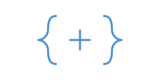
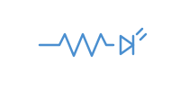
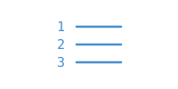

## Présentation sommaire du cours

Le cours **Objets connectés** initie l'étudiant aux capteurs d'environnement, aux différentes technologies d'affichage (écran ACL, diode lumineuse, etc.) et aux notions de base en électronique pour réaliser des objets connectés. À l'aide d'un microcontrôleur (Arduino Uno), il met en pratique des notions de base en programmation pour développer des applications simples. Finalement, l'étudiant est sensibilisé aux données générées par les objets connectés et aux manières de les sauvegarder et de les échanger de manière sécuritaire.

- **Programme** : 420.B0 · Techniques de l'informatique
- **Famille** : Mobiles et objets connectés
- **Pondération** : 1-3-2
- **Préalable** : Aucun

Outils : [Wokwi](https://wokwi.com/) et [TinkerCad](https://www.tinkercad.com/circuits) (émulateurs Arduino en ligne), PlatformIO et l'Arduino IDE.

## Horaire et disponibilités de l'enseignant

**Alain Boudreault**, enseignant au département de Techniques de l'informatique, Cégep de Saint-Jérôme

- **Courriel** : [Aboudrea@cstj.qc.ca](mailto:Aboudrea@cstj.qc.ca)
- **Téléphone** : poste 6516
- **Local** : D125e

[Disponibilités pour la session H26](images/Horaire-H26.png) · [Calendrier scolaire H26 (PDF)](Documents/Calendriers_H26_CSTJ.pdf)

## A) Plan de cours

 *Le plan officiel de la session*

-  - · [Plan de cours](Documents/420-1C4-JR_ab_pc_H26.pdf)
  - Session H26 · PDF officiel
-  - · [Plan de cours, version texte](Documents/Plan-de-cours.md)
  - Le même plan, lisible dans le fureteur

## B) Documents - Première étape du cours

 *Arduino, PlatformIO, C, affichage*

-  01 · [Introduction aux microcontrôleurs](Documents/Introduction-microcontroleurs.md)
  - Arduino Uno · émulateurs en ligne : Wokwi, TinkerCad
-  02 · [Introduction à PlatformIO](Documents/PlatformIO-Hello-world.md)
  - VS Code · structure d'un projet · platformio.ini · Hello World
-  03 · [Arduino IDE](Documents/Hello-world.md)
  - Hello World · DEL sur D13 · delay() · macros
-  04 · [Console série et bouton](Documents/Serial-println-et-digitalread.md)
  - Serial.println(val) · digitalRead() · while() · pull-up · rebond
-  05 · [Signaux analogiques](Documents/analogRead.md)
  - analogRead() · analogWrite() · PWM · map()
-  06 · [Écran LCD-RGB I2C](Documents/LCD-enum-ifdef.md)
  - sprintf · switch · #ifdef · opérateur ternaire · i % j
-  07 · [Compilation conditionnelle](Documents/Compilation-conditionnelle.md)
  - #ifdef · #ifndef · #else · macro de garde des fichiers .h
-  08 · [Les librairies](Documents/Utilisation-de-librairies.md)
  - Installer sous PlatformIO · Streaming · librairie locale · versions
-  09 · [Électronique](Documents/Electronique-concepts-de-base.md)
  - Concepts de base · tension, intensité, puissance, résistance
-  10 · [L'instruction enum](Documents/Instruction-enum.md) · TP02
  - Énumérations du langage C · gestion d'un menu
-  11 · [Structures de données](Documents/Structures-de-donnees.md)
  - struct · enum · tableau de structures
-  12 · [Opérations sur les bits](Documents/Operations-sur-les-bits-et-structure-de-donnees.md) · TP02
  - Opérateurs ET, OU, OU exclusif et NON · décalages · structures de données
-  13 · [Température et humidité](Documents/Capteur-temperature-humidite.md)
  - Capteur SHT31 · afficheur 7 segments 4-Digit (TM1637) · installer une librairie à la main

## C) Documents - Deuxième étape du cours

 *Capteurs, horloge, UART, Wi-Fi*

-  14 · [Buzzer et NeoPixel](Documents/NEOPixel.md)
  - Buzzer · barre de DEL RGB WS2813
-  15 · [Horloge temps réel](Documents/RTC-DS1307.md)
  - Real Time Clock (RTC) DS1307 · I2C · heure et date
-  16 · [Détecteur de mouvements](Documents/Detecteur-de-mouvements.md)
  - Capteur PIR ajustable · connexion digitale
-  17 · [Opérations non bloquantes](Documents/Operations-non-bloquantes.md) · TP02
  - millis() · interruptions matérielles · interruption Timer
-  18 · [Communication UART](Documents/Communication-UART-entre-2-arduino.md) · TP02
  - Entre deux Arduino · UART physique · SoftwareSerial
-  19 · [Accès Wi-Fi](Documents/ESP-Wifi.md) · TP02
  - Module UART Wifi V2 (ESP8285) · commandes AT · requêtes vers une API Web
-  20 · [Infrarouge](Documents/Infrarouge.md) · optionnel
  - Récepteur et émetteur Grove · télécommande · protocoles NEC et Sony
-  21 · [La mémoire EEPROM](Documents/EEPROM.md) · optionnel
  - Conserver des données sans alimentation · read, update, put et get
-  22 · [Capteur RFID](Documents/capteur-rfid.md) · optionnel · défi TP02
  - Module RFID de Grove

## D) Projet de session

 *Partie A et partie B*

-  23 · [Système de surveillance H26](Documents/TP01-H26.md)
  - Partie A · énoncé du TP01
-  24 · [Épreuve synthèse, volet A](Documents/ES-H26-Volet-A.md#partie-2)
  - Partie B · TP02 · transmission des données vers le Web
-  25 · [Centrale de surveillance](http://esh25.ve2cuy.com/index.php)
  - Les événements envoyés à l'API par les systèmes de la classe (ES, partie 2)

## E) Documents - Aide-mémoire et solutions

 *Copier/coller et solutions*

-  26 · [Les copier/coller](Documents/copier-coller.md)
  - Code de départ · séquences ANSI et boîtes · variables de type scalaire · bruit d'un bouton (bounce2)
-  27 · [Solutions aux laboratoires](Documents/Solutions.md)
  - NeoPixel · Real Time Clock DS1307
