<nav class="tiles" aria-label="Sections du cours">
  <a class="tile" href="#plan">
    
<svg viewBox="0 0 200 100" fill="none" stroke="currentColor" stroke-width="2.5" stroke-linecap="round" stroke-linejoin="round" role="img" aria-label="Plan de cours"><rect x="72" y="14" width="56" height="74" rx="5"/><rect x="88" y="8" width="24" height="12" rx="3"/><path d="M84 36h32M84 48h32M84 60h20M84 72h26"/></svg>

    
APlan de coursLe plan officiel de la session

  </a>
  <a class="tile" href="#bases">
    
<svg viewBox="0 0 200 100" fill="none" stroke="currentColor" stroke-width="2.5" stroke-linecap="round" stroke-linejoin="round" role="img" aria-label="Microcontrôleur"><rect x="62" y="28" width="64" height="48" rx="6"/><rect x="80" y="42" width="28" height="20" rx="3"/><path d="M72 28v-8M84 28v-8M96 28v-8M108 28v-8M120 28v-8M72 76v8M84 76v8M96 76v8M108 76v8M120 76v8"/><circle cx="148" cy="52" r="5"/><path d="M148 57v14"/></svg>

    
BDocuments 1 à 12Arduino, PlatformIO, C, affichage

  </a>
  <a class="tile" href="#capteurs">
    
<svg viewBox="0 0 200 100" fill="none" stroke="currentColor" stroke-width="2.5" stroke-linecap="round" stroke-linejoin="round" role="img" aria-label="Capteur sans fil"><rect x="68" y="34" width="44" height="44" rx="6"/><circle cx="90" cy="56" r="8"/><path d="M124 40a16 16 0 0 1 0 32M134 30a30 30 0 0 1 0 52"/></svg>

    
CDocuments 20 à 28Capteurs, horloge, UART, Wi-Fi

  </a>
  <a class="tile" href="#projet">
    
<svg viewBox="0 0 200 100" fill="none" stroke="currentColor" stroke-width="2.5" stroke-linecap="round" stroke-linejoin="round" role="img" aria-label="Projet de session"><path d="M78 88V14M78 18h46l-8 12 8 12H78"/><path d="M66 88h28"/></svg>

    
DProjet de sessionPartie A et partie B

  </a>
  <a class="tile" href="#ressources">
    
<svg viewBox="0 0 200 100" fill="none" stroke="currentColor" stroke-width="2.5" stroke-linecap="round" stroke-linejoin="round" role="img" aria-label="Ressources"><rect x="76" y="24" width="44" height="56" rx="5"/><path d="M68 70V20a6 6 0 0 1 6-6h36"/><path d="M86 42h24M86 54h24M86 66h14"/></svg>

    
E98 et 99Copier/coller et solutions

  </a>
</nav>

<section class="bloc" id="presentation">
  <h2>Présentation sommaire du cours</h2>
  
Le cours <strong>Objets connectés</strong> initie l'étudiant aux capteurs d'environnement, aux différentes technologies d'affichage (écran ACL, diode lumineuse, etc.) et aux notions de base en électronique pour réaliser des objets connectés. À l'aide d'un microcontrôleur (Arduino Uno), il met en pratique des notions de base en programmation pour développer des applications simples. Finalement, l'étudiant est sensibilisé aux données générées par les objets connectés et aux manières de les sauvegarder et de les échanger de manière sécuritaire.

  <dl class="faits">
    
<dt>Programme</dt><dd>420.B0 · Techniques de l'informatique</dd>

    
<dt>Famille</dt><dd>Mobiles et objets connectés</dd>

    
<dt>Pondération</dt><dd>1-3-2</dd>

    
<dt>Préalable</dt><dd>Aucun</dd>

  </dl>
  
Outils : <a href="https://wokwi.com/">Wokwi</a> et <a href="https://www.tinkercad.com/circuits">TinkerCad</a> (émulateurs Arduino en ligne), PlatformIO et l'Arduino IDE.

</section>

<section class="bloc" id="enseignant">
  <h2>Horaire et disponibilités de l'enseignant</h2>
  

    
    

      
Alain Boudreault

      
Enseignant au département de Techniques de l'informatique, Cégep de Saint-Jérôme

      <ul class="contact">
        <li>Courriel <a href="mailto:Aboudrea@cstj.qc.ca">Aboudrea@cstj.qc.ca</a></li>
        <li>Téléphone poste 6516</li>
        <li>Local D125e</li>
      </ul>
    

  

  

    <a class="btn-lien" href="images/Horaire-H26.png">Disponibilités pour la session H26</a>
    <a class="btn-lien" href="Documents/Calendriers_H26_CSTJ.pdf">Calendrier scolaire H26 (PDF)</a>
  

</section>

<section class="bloc" id="plan">
  <h2>A Plan de cours</h2>
  

    <a class="doc" href="Documents/420-1C4-JR_ab_pc_H26.pdf"><svg viewBox="0 0 200 100" fill="none" stroke="currentColor" stroke-width="2.5" stroke-linecap="round" stroke-linejoin="round" aria-hidden="true"><path d="M72 14h56a5 5 0 0 1 5 5v64a5 5 0 0 1-5 5H72a5 5 0 0 1-5-5V19a5 5 0 0 1 5-5z"/><rect x="88" y="8" width="24" height="12" rx="3"/><path d="M80 36h40M80 48h40M80 60h26M80 72h32"/></svg>01Plan de cours H26 (PDF)</a>
    <a class="doc" href="Documents/Plan-de-cours.html"><svg viewBox="0 0 200 100" fill="none" stroke="currentColor" stroke-width="2.5" stroke-linecap="round" stroke-linejoin="round" aria-hidden="true"><path d="M72 14h56a5 5 0 0 1 5 5v64a5 5 0 0 1-5 5H72a5 5 0 0 1-5-5V19a5 5 0 0 1 5-5z"/><rect x="88" y="8" width="24" height="12" rx="3"/><path d="M80 36h40M80 48h40M80 60h26M80 72h32"/></svg>+Plan de cours, version texte</a>
  

</section>

<section class="bloc" id="bases">
  <h2>B Documents 1 à 12</h2>
  

    <a class="doc" href="Documents/Introduction-microcontroleurs.html">02Introduction aux microcontrôleursArduino Uno · émulateurs en ligne : Wokwi, TinkerCad</a>
    <a class="doc" href="Documents/PlatformIO-Hello-world.html">03Hello World – PlatformIO</a>
    <a class="doc" href="Documents/Hello-world.html">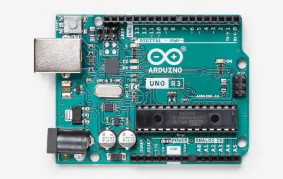+Hello World – Arduino IDE</a>
    <a class="doc" href="Documents/Serial-println-et-digitalread.html">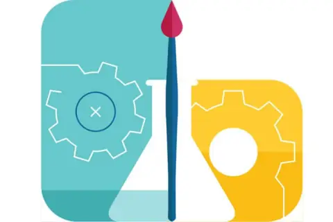04Serial.println(val), digitalRead() et while() pour la gestion du bouton</a>
    <a class="doc" href="Documents/analogRead.html">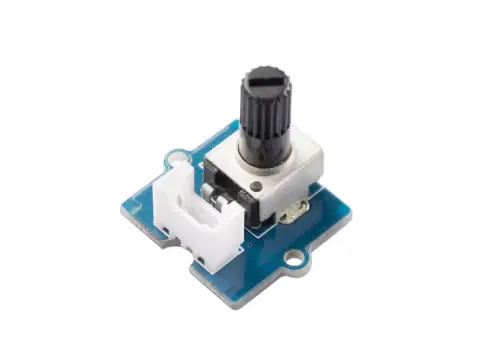05Lecture/écriture d'une valeur analogique – analogRead(), analogWrite(), PWM</a>
    <a class="doc" href="Documents/LCD-enum-ifdef.html">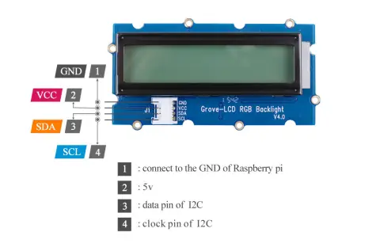06Grove – Module LCD-RGB i2c (sprintf, switch, #ifdef, op ternaire, i % j)</a>
    <a class="doc" href="Documents/Compilation-conditionnelle.html">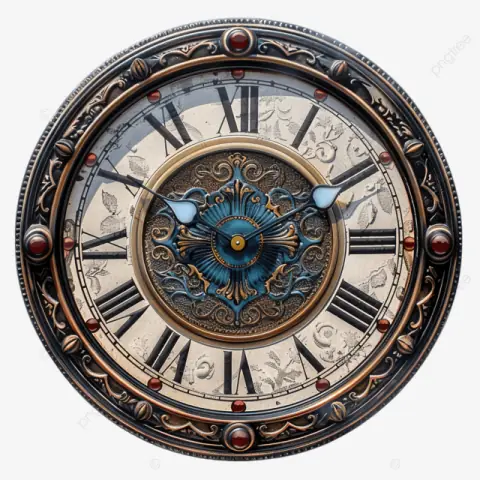07Compilation conditionnelle</a>
    <a class="doc" href="Documents/Utilisation-de-librairies.html">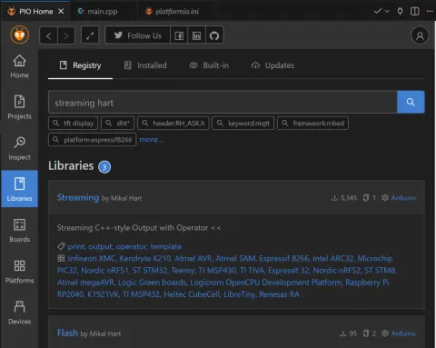+Les librairies</a>
    <a class="doc" href="Documents/Electronique-concepts-de-base.html">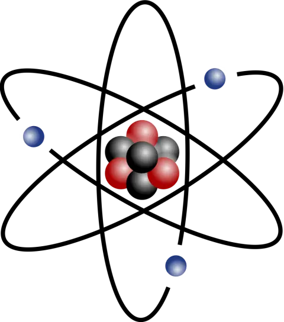+Électronique – concepts de base</a>
    <a class="doc" href="Documents/Instruction-enum.html">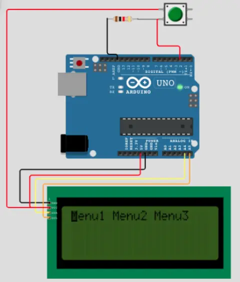08L'instruction « enum » du langage CTP02</a>
    <a class="doc" href="Documents/Structures-de-donnees.html">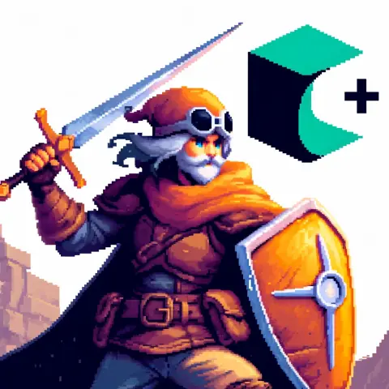09Structures de données</a>
    <a class="doc" href="Documents/Operations-sur-les-bits-et-structure-de-donnees.html">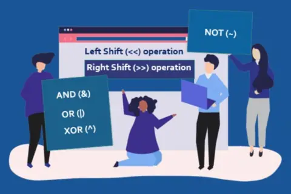10Opérations sur les bits et structures de donnéesTP02</a>
    <a class="doc" href="Documents/copier-coller.html">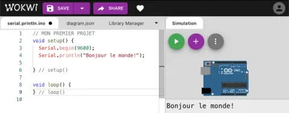11Copier/coller pour ANSI et boîteLes variables de type scalaire · gestion du bruit sur un bouton – bounce2</a>
    <a class="doc" href="Documents/Capteur-temperature-humidite.html">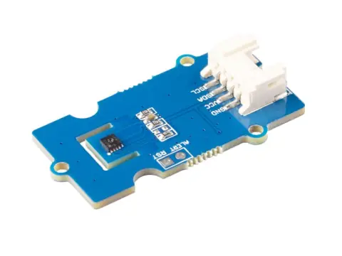12Température, humidité et affichage sur 7 segments – 4DigitInstaller une librairie à la main</a>
  

</section>

<section class="bloc" id="capteurs">
  <h2>C Documents 20 à 28</h2>
  

    <a class="doc" href="Documents/NEOPixel.html">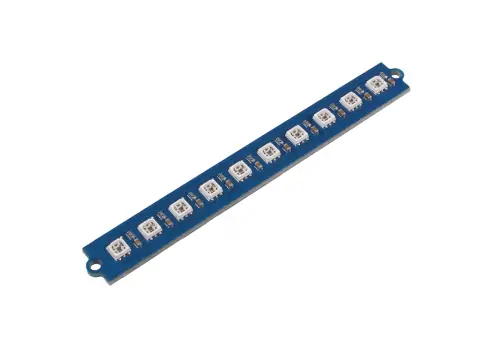20Buzzer et NeoPixel</a>
    <a class="doc" href="Documents/RTC-DS1307.html">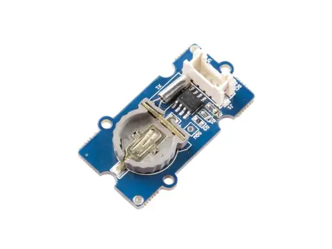21Real Time Clock (RTC)</a>
    <a class="doc" href="https://ve2cuy.com/420-1c4/index.php/detecteur-de-mouvements/"><svg viewBox="0 0 200 100" fill="none" stroke="currentColor" stroke-width="2.5" stroke-linecap="round" stroke-linejoin="round" aria-hidden="true"><circle cx="100" cy="54" r="10"/><path d="M82 36a26 26 0 0 0 0 36M118 36a26 26 0 0 1 0 36M70 26a42 42 0 0 0 0 56M130 26a42 42 0 0 1 0 56"/></svg>22Détecteur de mouvements</a>
    <a class="doc" href="Documents/Operations-non-bloquantes.html"><svg viewBox="0 0 200 100" fill="none" stroke="currentColor" stroke-width="2.5" stroke-linecap="round" stroke-linejoin="round" aria-hidden="true"><circle cx="100" cy="54" r="30"/><path d="M100 54V36M100 54l12 8M92 14h16M100 14v10"/></svg>23Opérations non bloquantes – millis() et interruptionsTP02</a>
    <a class="doc" href="Documents/Communication-UART-entre-2-arduino.html">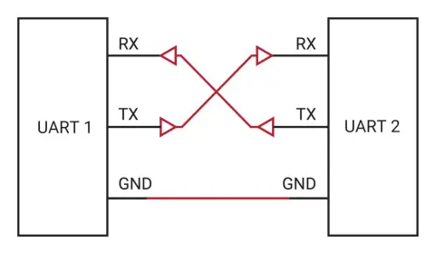24Communication UART entre deux ArduinoTP02</a>
    <a class="doc" href="Documents/ESP-Wifi.html">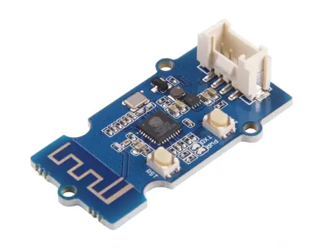25ESP-Wifi – accès réseauTP02</a>
    
<svg viewBox="0 0 200 100" fill="none" stroke="currentColor" stroke-width="2.5" stroke-linecap="round" stroke-linejoin="round" aria-hidden="true"><rect x="70" y="30" width="44" height="48" rx="6"/><circle cx="92" cy="54" r="10"/><path d="M124 44l14-6M124 54h16M124 64l14 6"/></svg>26Détecteur infrarougeoptionnel

    
<svg viewBox="0 0 200 100" fill="none" stroke="currentColor" stroke-width="2.5" stroke-linecap="round" stroke-linejoin="round" aria-hidden="true"><rect x="68" y="24" width="64" height="52" rx="5"/><path d="M80 24v-10M92 24v-10M104 24v-10M116 24v-10M80 76v10M92 76v10M104 76v10M116 76v10M84 44h32M84 56h20"/></svg>27EEPROMoptionnel

    <a class="doc" href="Documents/capteur-rfid.html">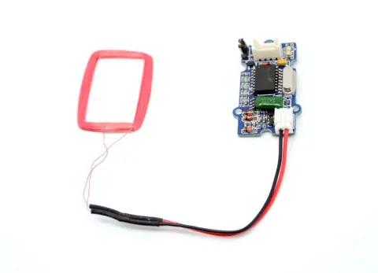28Capteur RFIDoptionnel · défi TP02</a>
  

</section>

<section class="bloc" id="projet">
  <h2>D Projet de session</h2>
  

    <a class="doc" href="Documents/TP01-H26.html">APartie A · TP01 – Le système de surveillance H26</a>
    <a class="doc" href="Documents/ES-H26-Volet-A.html">BPartie B · TP02 – Épreuve synthèse, volet A</a>
  

</section>

<section class="bloc" id="ressources">
  <h2>E 98 et 99</h2>
  

    <a class="doc" href="Documents/copier-coller.html">98Les copier/coller</a>
    <a class="doc" href="Documents/Solutions.html"><svg viewBox="0 0 200 100" fill="none" stroke="currentColor" stroke-width="2.5" stroke-linecap="round" stroke-linejoin="round" aria-hidden="true"><circle cx="100" cy="52" r="32"/><path d="M84 52l11 11 21-22"/></svg>99Solutions aux laboratoires</a>
  

</section>
